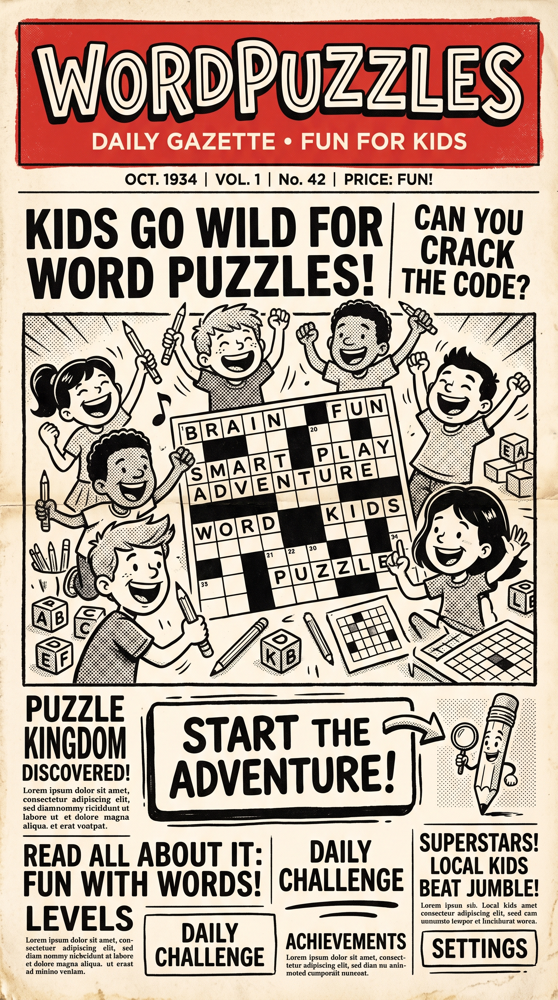

# Word Puzzles - Word Search & Crossword Game

<div align="center">
  
  <p><strong>Interactive Word Search and Crossword Puzzles for Kids!</strong></p>
</div>

## 🎮 About the App

A fun and engaging word puzzle game featuring **Crosswords** and **Word Search** puzzles designed for children of all ages. Based on the newspaper-style design shown in the attached image!

## 🚀 Quick Start

1. Open your browser to **`http://localhost:56400/`**
2. Click the **"Start Adventure"** button on the opening screen
3. Choose your puzzle type:
   - **Crossword**: Classic grid puzzle with clues
   - **Word Search**: Find hidden words in a grid
4. Select your difficulty:
   - **Easy**: Shorter words (3-6 letters)
   - **Medium**: Medium-length words (5-8 letters)
   - **Hard**: Longer, challenging words (7+ letters)
5. Choose the number of words: **10, 14, or 16**
6. Click **"Start Game"** and begin solving!

## 📱 Features

### Opening Screen
- 🎨 Newspaper-inspired design with vibrant colors
- Kids-friendly interface with fun graphics
- Big, clear "Start Adventure" button

### Selection Screen
- Choose between **Crossword** and **Word Search**
- Select difficulty level (Easy, Medium, Hard)
- Choose puzzle size (10, 14, or 16 words)
- Form validation to ensure all selections are made

### Game Screen - Crossword Mode
- **Puzzle grid** at the top with numbered squares
- **Two columns of clues** below (Across and Down)
- Click on numbered squares to open clue modal
- **Clue Modal** features:
  - Question/clue text
  - Input box for your answer
  - **Validate** button to check your answer
  - **Cancel** button to close without answering
  - **Hint** button for a clue hint
  - Real-time feedback (✓ Correct! or ✗ Try Again!)

### Game Screen - Word Search Mode
- Letter grid with hidden words
- Word list at the bottom
- Click on letters to reveal words
- Mark words as found

### Clue System
- Each clue has a **number** on the grid
- Click the number to see the clue modal
- Type your answer (case-insensitive)
- Get instant feedback on your answer

## 🎯 How to Play

### Crossword Puzzle
1. Look at the numbered squares in the grid
2. Click on a numbered square
3. A modal opens with the clue
4. Type in your answer
5. Click **"Validate"** to check if it's correct
6. If correct, the word fills in the grid and you get a ✅
7. If incorrect, you get a ❌ and can try again
8. Click **"Hint"** for a hint
9. Click **"Cancel"** to close the modal

### Word Search Puzzle
1. Study the word list
2. Find the words in the letter grid (horizontally, vertically, or diagonally)
3. Click on each letter of a word to select it
4. Words will highlight when found!

## 🎨 Design Inspiration

The app is inspired by the newspaper-style "Daily Gazette" design with:
- 📰 Vintage newspaper header
- 🎨 Black and white illustrations with kids
- ✏️ Fun pencil mascot
- 🏆 "Puzzle Kingdom" theme
- 🌟 "Start the Adventure!" message

## 🛠️ Tech Stack

- **React 18** - UI library
- **TypeScript** - Type-safe JavaScript
- **Vite** - Fast build tool and dev server
- **Oxlint** - Fast TypeScript linter
- **CSS3** - Modern styling with animations

## 📁 Project Structure

```
crossword-wordsearch/
├── public/
│   └── background.jpg          # Opening screen background
├── src/
│   ├── components/
│   │   ├── OpeningScreen.tsx   # Main menu
│   │   ├── SelectionScreen.tsx # Puzzle selection
│   │   ├── GameScreen.tsx      # Puzzle display
│   │   └── ClueModal.tsx       # Clue answer modal
│   ├── types/
│   │   └── index.ts            # TypeScript types
│   ├── App.tsx                 # Main app component
│   └── App.css                # Styles
└── package.json
```

## 🎯 Next Steps

The app is currently a **demo version** with basic puzzle generation. To make it fully functional:

### TODO:
1. ✅ **Background Image** - Add your newspaper-style background
2. ⏳ **Clue Generation** - Process your JSON files to create puzzle clues
3. ⏳ **Puzzle Generation** - Create crossword grids and word search grids
4. ⏳ **Difficulty Filtering** - Filter clues by word length and complexity
5. ⏳ **Game Logic** - Implement full crossword and word search gameplay
6. ⏳ **Score Tracking** - Keep track of correct answers
7. ⏳ **Level Progression** - Multiple puzzle levels

## 🎮 Controls

- **Mouse/Touch**: Click on grid squares and clue buttons
- **Input**: Type answers in the modal
- **Validate**: Check if your answer is correct
- **Cancel**: Close the modal without answering
- **Hint**: Get a hint for the clue
- **Back Button**: Return to selection screen

## 🎨 Color Scheme

The app uses a fun, kid-friendly color palette:
- **Primary**: Red (#ff6b6b)
- **Secondary**: Yellow (#feca57)
- **Accent**: Cyan (#48dbfb)
- **Background**: Deep purple (#1a1a2e)
- **Text**: White with gradients

## 👨‍💻 Developer Notes

- The app uses TypeScript for type safety
- Components are modular and reusable
- Styled with CSS (no framework)
- Responsive design for mobile devices
- Keyboard accessible

## 🎉 Credits

- **Design Inspiration**: Your attached newspaper image
- **Data Source**: Your word dictionary JSON files
- **Development**: Bionic AI Assistant

---

**Happy Puzzle Solving! 🎯✨**